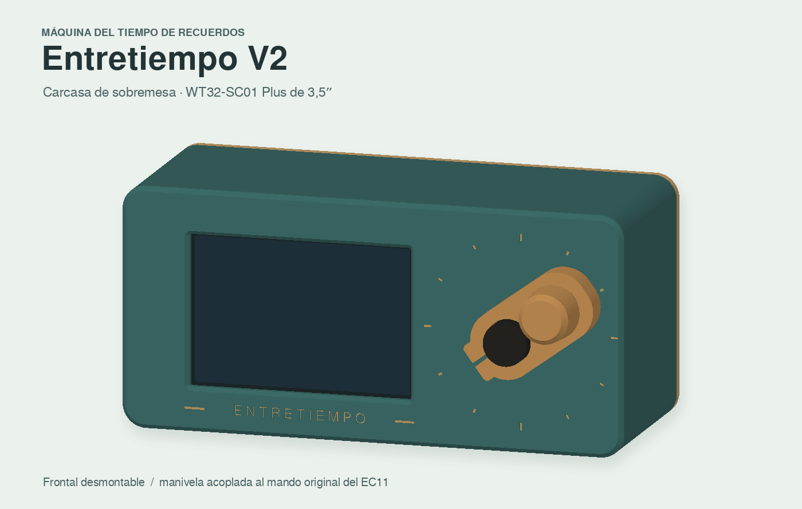

# Entretiempo V2

Carcasa de sobremesa para la **Wireless-Tag WT32-SC01 Plus** con su marco negro de fábrica. Esta revisión permite imprimir y probar el frontal con la pantalla y el encoder antes de montar el cuerpo. La tapa trasera abre con cuatro tornillos y extrae la bandeja de batería.



## Orden de impresión y prueba

1. **Imprime las dos plantillas `07` y `08` primero**, con el mismo material y perfil del frontal. La de pantalla replica los apoyos y guías reales del frontal. Con los puertos a la izquierda vistos desde delante, presenta la Plus completa, con su marco original, sin forzar. Comprueba que entra, asienta plano y deja toda el área activa visible. La del mando tiene agujeros de Ø15,25, Ø15,55 y Ø15,85 mm, señalados con uno, dos y tres puntos. Debe entrar a mano con poco juego. La manivela suministrada usa el segundo diámetro. Si el primero o el tercero son los adecuados, cambia `mando_holgura` a 0,25 o 0,85 mm y exporta de nuevo.
2. **Imprime el frontal `01`, dos raíles `04` y el soporte del encoder que corresponda**. Monta pantalla y encoder en el frontal suelto. Comprueba que la pantalla queda centrada y firme con la junta puesta, y que el mando gira y recupera el pulsador. El cuerpo y la tapa se pueden adelantar en una impresión aparte. Los ajustes de la pantalla y el casquillo se hacen en las piezas del frontal.
3. **Imprime o recupera el cuerpo `02`, la tapa `03` y la manivela `06`**. Antes de cerrar, enchufa el USB-C y prueba a expulsar y coger la microSD por la abertura trasera izquierda. Prueba el táctil cerca de las cuatro esquinas y monta la tapa.

Usa PETG, boquilla de 0,4 mm, capa de 0,20 mm, cuatro perímetros y 20–25 % de relleno como punto de partida. Usa cinco perímetros en el soporte del encoder y la manivela. Las orientaciones del STL ya están preparadas. Revisa los pasos horizontales de los tornillos en la vista por capas. Comprueba el tiempo real en tu laminador. El cuerpo mide **172 × 82 mm** en la cama, más el margen de adhesión si se usa.

## Montaje de la pantalla y el cierre

- **Conserva el marco negro.** La holgura de las guías es de 0,60 mm por canto sobre los 92 × 60 mm nominales. El paso de la ventana es 76 × 51,6 mm para un área visible de 74,04 × 49,56 mm. La referencia de los cuatro tetones traseros es 75,14 × 51,39 mm, con taladro Ø2,3 mm acotado en el plano. Consulta las [referencias y licencias](REFERENCIAS.md).
- **Junta perimetral.** Recorta espuma de célula cerrada de 1 mm con la [plantilla a escala 1:1](fabricacion/junta-pantalla-1a1.svg). La junta continua va en el anillo plano interior del frontal, alrededor de la ventana. Preséntala sobre la franja negra de la pantalla y comprueba que no invade el área activa. Los raíles comprimen la junta suavemente. La bahía de puertos y el eje siguen comunicados con el exterior. El cierre alrededor de la pantalla se diseñó para evitar una rendija visible y reducir la entrada de polvo por ese perímetro.
- **Sujeción trasera.** Coloca los dos raíles con su extremo desviado hacia el lado de los puertos. Voltea uno para orientar ambos desvíos hacia fuera. Adhiere una almohadilla de espuma de 2 mm sobre cada apoyo de plástico rígido, cerca de los cuatro tetones. Comprueba desde atrás que los raíles y las almohadillas dejan libres la placa, el cable plano y los conectores. Aprieta los cuatro M3 × 12 en cruz hasta que la pantalla deje de moverse y la junta quede levemente comprimida. Las ranuras de los raíles también sirven para localizar los tetones y admitir su tornillería si has verificado el tipo de rosca y la profundidad. El montaje con almohadillas evita atornillar al módulo.
- **Cierre.** Coloca el frontal en los cuatro alojamientos del cuerpo. Fija los M3 × 10 desde atrás con un destornillador largo. Estos tornillos se quedan instalados al abrir la tapa. La tapa va con cuatro M3 × 8 por detrás. Pega cuatro pies adhesivos en la base, cerca de sus extremos delantero y trasero.

## Montaje del EC11

| Con qué llega el encoder | Soporte |
|---|---|
| Casquillo que pasa con poco juego por Ø7,4 mm y tuerca compatible | `05-soporte-encoder` |
| Casquillo que pasa con poco juego por Ø7,4 mm y falta la tuerca | `10-soporte-encoder-abrazadera`, con un M3 × 20 y tuerca M3 |
| Otro diámetro | `09-soporte-encoder-piloto` con tuerca del encoder o `11-abrazadera-piloto` sin ella. Los dos tienen Ø5,8 mm para ajustar a broca o lima. También se puede editar `casquillo_d` y regenerar. |

1. Fija el encoder al soporte antes de colocar este último en el frontal. Con la versión plana, aprieta su tuerca sobre la cara delantera del soporte. Con la versión de abrazadera, sienta el hombro contra la placa y cierra la ranura con el tornillo lateral. El cuerpo debe quedar inmóvil al girar y al pulsar.
2. Instala el soporte desde atrás con dos M3 × 6. Enchufa o suelda el cableado dejando holgura. Desde delante, monta el **mando negro original** sobre su eje estriado. La manivela se abraza a ese mando con un M3 × 20 y tuerca. Aprieta hasta que ambos giren juntos. El brazo se mantiene corto, con 20 mm entre ejes. Deja suficiente distancia al frontal para que el pomo pueda hundirse y recuperar su posición sin rozar.
3. Prueba primero con el mando original y luego con la manivela. Si aún te falta el tornillo de la manivela, el mando de serie permite usar el encoder mientras tanto.

### Tornillería y material

| Cantidad | Material |
|---:|---|
| 4 | M3 × 10 para unir frontal y cuerpo |
| 4 | M3 × 8 para la tapa |
| 4 | M3 × 12 para los raíles |
| 2 | M3 × 6 para el soporte del encoder |
| 1 o 2 | M3 × 20 y tuerca M3. Uno para la manivela y otro si se usa soporte de abrazadera. |
| 1 | Tuerca y arandela del encoder, solo para el soporte plano |
| 1 | Junta de espuma de célula cerrada de 1 mm y cuatro almohadillas de 2 mm |
| 4 | Pies adhesivos de goma o silicona |

Los alojamientos M3 se imprimen como agujeros piloto Ø2,65 mm. Pasa un macho M3 o forma la rosca con cuidado y verifica el ajuste en las piezas pequeñas antes de montar la carcasa.

## Volumen reservado y comprobaciones

El cuerpo con tapa mide **172 × 82 × 67 mm**. La bandeja deja **78 × 44 × 22 mm útiles** para batería y **28 × 44 × 22 mm** para módulos, antes de sumar sujeciones y cables. Tiene pasos para cableado y se accede quitando los cuatro tornillos traseros. La primera versión usa el USB-C de la Plus. La elección de batería, fijación, carga, protección, conversión y conexión eléctrica sigue pendiente.

Se verificaron mallas y sólidos STEP, interferencias entre las piezas, reservas de la bandeja y envolventes de USB, microSD, pantalla y encoder. La prueba de giro en CAD incluye un avance simulado de 1,2 mm. Las dimensiones reales del casquillo, el mando, los apoyos traseros y el conector del cable se comprueban al recibir las piezas. Usa las plantillas para confirmar el ajuste antes de comprometer una impresión larga.

## Archivos editables

- [STL](fabricacion/stl/) · [STEP del conjunto](fabricacion/step/00-conjunto.step) · [vista interior](vistas/02-interior.png) · [despiece](vistas/03-despiece.png)
- [CAD paramétrico en build123d](cad/entretiempo.py). Edita `Medidas`. Usa Python 3.13, build123d 0.13 y la tipografía GNU FreeSans.

```sh
python -m pip install build123d==0.13.0
python cad/entretiempo.py
```
