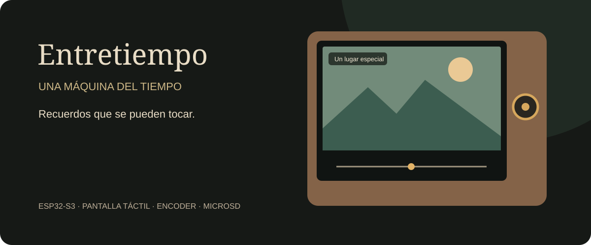
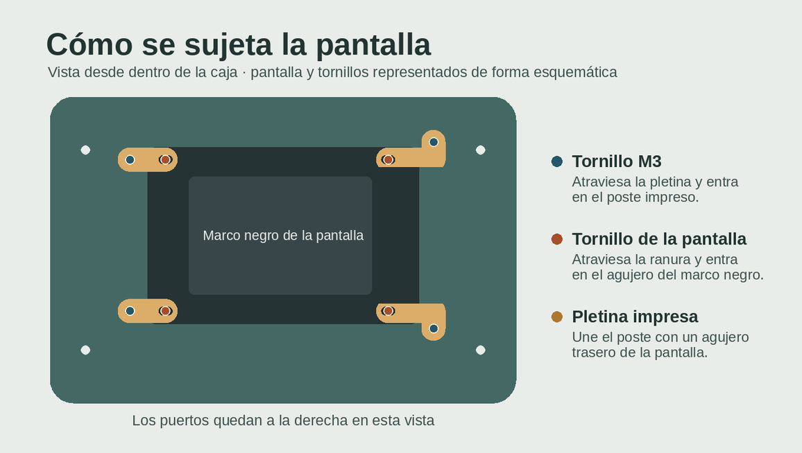

# Entretiempo

### Una máquina del tiempo para tus recuerdos

Un álbum de fotos físico y conectado: gira una ruedita para recorrer los años, toca una imagen para leer su historia y gestiona la colección desde el móvil. Entretiempo combina firmware para ESP32-S3, una interfaz táctil, un panel web local y piezas diseñadas para fabricación digital.



*Ilustración conceptual de la interfaz y el mando.*

## La experiencia

- **Una línea del tiempo tangible.** El encoder recorre la colección por fecha; la barra inferior permite saltar a otro momento con un toque. Las fotografías se presentan con una transición animada.
- **Más que imágenes.** Cada fotografía puede tener fecha, ubicación y una nota. La pantalla muestra un adelanto de la nota y permite leerla o editarla con el teclado táctil.
- **Recuerdos con contexto.** El panel extrae metadatos EXIF; para coordenadas en España busca una localidad cercana sin depender de internet y conserva también las coordenadas.
- **Todo desde el navegador.** El panel permite subir varias imágenes, editar fichas y eliminar fotos individualmente o en lote. Detecta duplicados cuando coincide el JPEG adaptado.
- **Conectividad flexible.** Funciona en una red Wi-Fi de 2,4 GHz o mediante su propio punto de acceso. Un QR en la pantalla indica cómo abrir el panel.
- **Una bienvenida especial.** Se puede activar una introducción para el próximo arranque; si se interrumpe, vuelve a aparecer hasta terminarla.

## Cómo está construido

| Pieza | Función |
| --- | --- |
| Wireless-Tag WT32-SC01 Plus | ESP32-S3, pantalla táctil de 3,5 pulgadas y 480 × 320, Wi-Fi y lector microSD |
| Encoder rotatorio EC11 con pulsador | Navegación física y apertura de notas o edición de metadatos |
| microSD FAT32 | Almacenamiento local de las imágenes adaptadas y sus fichas JSON |
| Batería Li-ion de una celda, 3300 mAh | Alimentación portátil del montaje realizado |
| BMS, módulo de carga USB-C y convertidor elevador a 5 V | Protección, carga y alimentación de la pantalla; módulos independientes |
| Frontal y soportes impresos | Fijación de la pantalla y el mando en una caja de madera |

### Conexiones

```text
                         ┌────────────────────────────┐
                         │ WT32-SC01 Plus             │
Encoder EC11 A ──────────┤ GPIO 10                    │
Encoder EC11 B ──────────┤ GPIO 11                    │
Pulsador ────────────────┤ GPIO 12                    │
Comunes ─────────────────┤ GND                        │
                         │ pantalla táctil + microSD  │
                         └─────────────▲──────────────┘
                                       │ 5 V y GND
Batería Li-ion 1S ── BMS ── elevador a 5 V
        │
        └── módulo de carga USB-C para Li-ion 1S
```

El encoder utiliza las resistencias pull-up internas; intercambia A y B si el giro queda invertido. El esquema de alimentación describe **la arquitectura del montaje**, no el pinout de módulos concretos: identifica sus bornes y sigue las especificaciones del cargador, BMS y convertidor elegidos. En el montaje original el elevador procede de una placa AIO de un dron; puede sustituirse por uno adecuado. La batería no dispone de sensor de tensión, por lo que el firmware no muestra un porcentaje de carga.

## Diseño y fabricación

El diseño para **caja de madera** incluye frontal, pletinas de fijación, mando lateral y plantilla de corte. También se conserva una carcasa de sobremesa completamente impresa, con su propio montaje.

| Caja de madera | Carcasa impresa V2.1 |
| --- | --- |
| [Guía, medidas y montaje](caja-madera/README.md) | [Guía de impresión y montaje](GUIA-CARCASA-IMPRESA.md) |
| [STL y STEP](caja-madera/) | [STL](fabricacion/stl/) · [STEP](fabricacion/step/) |



*Vista CAD de la fijación de la pantalla en el frontal de madera.*

Los archivos son un punto de partida: comprueba las dimensiones de tu pantalla, encoder, tornillos y caja antes de fabricar las piezas definitivas. Consulta las [referencias y licencias de terceros](REFERENCIAS.md).

## Software

El firmware está escrito en C con **ESP-IDF y LVGL**. El panel web se sirve desde el dispositivo; el navegador adapta las fotografías y el firmware las guarda en la microSD. El índice y la caché permiten recorrer colecciones grandes sin cargar todos los archivos al mismo tiempo.

Para compilar necesitas ESP-IDF 5.5.6, Node.js y una tarjeta microSD FAT32. Desde la raíz del proyecto:

```sh
python3 tools/provision.py --name Alex --birth 2000-01-01
npm --prefix firmware/web ci
npm --prefix firmware/web run build
idf.py -C firmware reconfigure build
idf.py -C firmware -p /dev/ttyACM0 flash monitor
```

El script pide una contraseña y crea una configuración local ignorada por Git. Los binarios compilados incluyen esa configuración: no compartas imágenes de firmware personalizadas ni tu archivo local de credenciales. El panel funciona por HTTP en la red local. Las cadenas de bienvenida y algunos recursos del diseño están personalizados en el código y pueden adaptarse antes de compilar.

La [guía de firmware](firmware/README.md) explica la preparación de la tarjeta, el acceso al panel, la edición de fotos y las pruebas en placa.

## Estructura

```text
firmware/       Firmware ESP32-S3 y panel web
caja-madera/    Frontal, soportes y plantilla para caja de madera
cad/            Diseño paramétrico de la carcasa impresa
fabricacion/    Archivos STL, STEP y plantillas de la carcasa impresa
vistas/         Vistas CAD de la carcasa impresa
tools/          Configuración del perfil y preparación de la microSD
```
