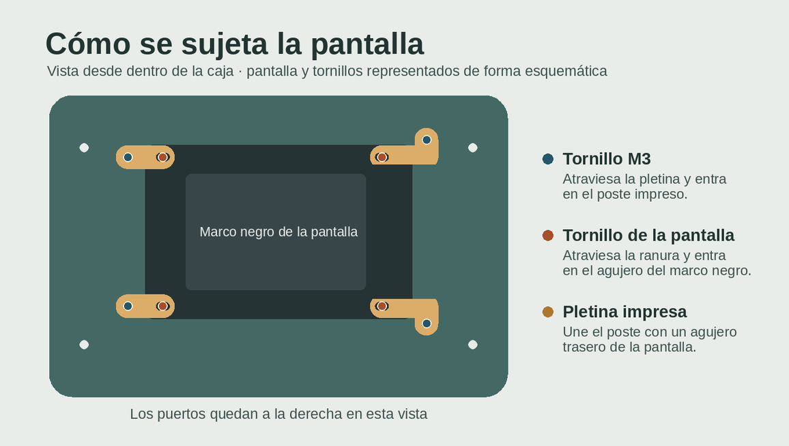

# Entretiempo · caja de madera

Frontal centrado para la **WT32-SC01 Plus con su marco negro original**, y manivela independiente para montar el EC11 en un lateral de la caja. El frontal tiene el nombre grabado en grande, un borde perimetral, un marco alrededor de la pantalla, marcas inspiradas en una esfera de reloj y un bisel exterior redondeado.

| Medida | mm |
| --- | ---: |
| Frontal exterior | 158 × 104 |
| Grosor de la placa | 3,2 |
| Desde el apoyo del marco negro hasta la boca del tetón | 10,0 |
| Altura del poste desde la cara interior del frontal | 10,8 |
| Ventana de pantalla | 76 × 51,6 |
| Envolvente mínima de los cuatro postes | 111 × 71,5 |
| Corte rectangular en la madera | 116 × 76 |
| Patrón de los cuatro tornillos de madera | 134 × 68 |
| Distancia entre centros de los anclajes traseros de la pantalla | 75,5 × 51,5 |
| Envolvente de la manivela | 61 × 24 × 27 |
| Acople ciego al mando negro original | Ø15,55 × 10 de tramo cilíndrico |

El recorte deja 2 mm de margen lateral en el lado más ajustado y 2,25 mm arriba y abajo respecto a los postes. El reborde cubre **21 mm a cada lado**, **9 mm arriba** y **19 mm abajo** en los ejes centrales. Centra el rectángulo de izquierda a derecha y desplázalo 5 mm hacia arriba respecto al centro del frontal. Usa la [plantilla de corte a escala 1:1](plantilla-corte-1a1.svg), con las opciones de escala al 100 %, y mide su línea de 50 mm antes de marcar la madera.

## Caja

Como punto de partida, busca **210 × 150 × 135 mm exteriores (ancho × fondo × alto)**, con tapa abatible. En la pared delantera del cuerpo, debajo de la tapa, busca una zona plana continua de **al menos 175 × 115 mm** para el frontal y sus márgenes. Comprueba esta zona en la caja concreta, porque la altura exterior incluye la tapa y la base. Una pared delantera de **5–8 mm** es un buen punto de partida. Deja accesibles desde la tapa los puertos y el interior del frontal. Alimenta la pantalla por USB-C y saca el cable por detrás.

## Impresión y montaje

1. Imprime [el frontal](frontal-madera.stl) en PETG, con la cara exterior hacia la cama tal como viene orientado el STL. Como punto de partida, usa capas de 0,20 mm y cuatro perímetros. Revisa las primeras capas en el laminador para conservar el grabado de 0,65 mm. Para darle el acabado de la vista, rellena las letras y las ranuras con pintura dorada después de imprimir.
2. Presenta la pantalla en el frontal suelto, con el marco negro original y los puertos a la izquierda vistos desde fuera. Las guías bajas centran el marco con 0,6 mm de holgura nominal por canto. Coloca la [junta de espuma de 1 mm](../fabricacion/junta-pantalla-1a1.svg) contra el borde negro, fuera del área visible. Imprime **dos** [pletinas con codo](pletina-puertos.stl) para el lado de los puertos y **dos** [pletinas rectas](pletina-opuesta.stl) para el otro lado. Dale la vuelta a una pletina con codo para que cada codo apunte hacia el canto más próximo. Cada pletina une un poste impreso y un tetón trasero del marco. Pasa un **M3 × 10** por el agujero redondo hacia el poste y un **tornillo corto compatible con tu pantalla** por la ranura hacia el tetón negro. Presenta todos los tornillos flojos y asienta en cruz con la junta levemente comprimida. Verifica la profundidad y el tipo de tornillo de pantalla con tu unidad. Si la pletina no asienta plana sobre ambos apoyos, mide el desnivel antes de apretar. Comprueba el táctil, el USB-C y la extracción de la microSD. [STEP del montaje](montaje-frontal.step)
3. Marca y corta el rectángulo, y presenta el frontal con la pantalla instalada antes de fijarlo. Prueba el acceso a los puertos desde el interior con el cable real. Si el canto de la madera estorba, límalo por dentro con el frontal retirado. Fija el frontal desde fuera con cuatro tornillos de cabeza avellanada, con vástago de hasta Ø3 mm y cabeza de hasta Ø6,3 mm. Escoge el largo según el grosor real de la madera y haz taladros piloto. Aprieta a mano hasta que asiente.
4. Imprime [la manivela](manivela-lateral.stl) en PETG con cinco perímetros. El alojamiento ciego entra desde el lado de la caja sobre el **mando negro de Ø15 mm**, que conserva su encaje en el eje estriado del EC11. La tapa integrada oculta el extremo del eje. Presenta el mando en el alojamiento y aprieta un M3 × 20 con tuerca por el lateral hasta que la manivela gire solidaria con el mando. Comprueba el giro y la pulsación antes de fijar el encoder en la madera. Si tienes dudas sobre el diámetro del mando, prueba antes la [plantilla de mando del repo](../fabricacion/stl/08-plantilla-mando.stl). El brazo mide 34 mm entre ejes y lleva un pomo perfilado.
5. Antes de taladrar el lateral, monta el encoder con su tuerca y arandela en un retal del mismo grosor. El agujero se dimensiona al **casquillo roscado que midas**. Comprueba que queda rosca para apretar y que el mando se hunde y vuelve sin rozar. Si la pared es gruesa, puedes rebajar por dentro alrededor del agujero hasta el grosor que funcione en el retal. Si tu EC11 carece de casquillo roscado y tuerca, necesita fijación interior. Coloca el centro del eje a **53 mm o más** de bordes, patas o herrajes que puedan estorbar el giro y el agarre.

Se verificaron los sólidos y las mallas en FreeCAD. El ajuste con las piezas físicas y el espesor de tu caja queda por probar.

## CAD

Los STEP se pueden abrir en FreeCAD. El conjunto muestra las cuatro pletinas colocadas, con el asiento nominal a 14,0 mm de la cara exterior del frontal (3,2 mm de placa, 0,8 mm de junta comprimida y 10,0 mm hasta el tetón de la pantalla). `generar.py` regenera los STEP, los STL y la plantilla con el Python de FreeCAD, pasándole la ruta a `LiberationSans-Bold.ttf`. El acople al mando parte del STEP de Entretiempo V2.1. El retranqueo horizontal del primer agujero (10,34 mm desde el borde del marco) parte de las cotas de Entretiempo V2.1. El paso de los cuatro agujeros toma las medidas de la unidad fotografiada.
